<div align="center">
  

  <br>

  <a href="https://www.linkedin.com/in/colinkthomas"></a> <a href="https://leetcode.com/u/OKTRBpaERN"></a> 
</div>

<br>

I like problems where the obvious fix doesn't work and you have to understand the layer underneath. For example, why a broker restart drops messages it already acknowledged, why `xrandr` can't add a display mode on Wayland, or why meeting notes take a minute to appear when they could take fifteen seconds.

Most of what I build is backend services in Python, deployed on small AWS servers and tested under load and failure. I also work on Linux tooling and robotics.

---

## 🖥️ Now building: [linuxcru](https://github.com/colin-110/linuxcru)

<table>
<tr>
<td width="52%" valign="top">

Many laptop panels sold as 60 Hz run fine at a higher refresh rate. Windows has CRU for this. On Linux, you have to work out a dozen timing values by hand, build a binary EDID file and edit GRUB.

linuxcru does it from one number. Type a refresh rate, and it calculates the timings, writes a valid EDID and installs it as a kernel firmware override. It works on Wayland, X11 and with Secure Boot.

- Qt window and a CLI, with `--dry-run` for every change
- Only a small helper runs as root, and GRUB recovery mode always boots without the override
- The installer is tested against a fake filesystem, and the timing math is checked against `cvt` and `edid-decode`
- Running on my own laptop: **60 → 96 Hz**

<sub>`Python` `PySide6` `EDID` `GRUB` `initramfs` `pytest` `mypy`</sub>

</td>
<td width="48%" valign="top">
  
</td>
</tr>
</table>

## 🛠️ Projects

<table>
<tr>
<td width="50%" valign="top">

### [FleetOps](https://github.com/colin-110/robot-fleet-platform)
<a href="https://robot-fleet-platform.vercel.app"></a>

Live map, alarms and commands for a robot fleet. A reading is acknowledged only after it is committed, and robots keep an on-disk outbox. In chaos tests that killed the robots, the API or the broker mid-stream, every reading was still stored exactly once. The system handles 1,000 robots at about 40% of one CPU core.

<sub>`FastAPI` `MQTT` `TimescaleDB` `React` · **[live demo](https://robot-fleet-platform.vercel.app)**</sub>

</td>
<td width="50%" valign="top">

### [Lumen](https://github.com/colin-110/lumen)
<a href="https://lumen-three-nu.vercel.app"></a>

Ask questions across your documents and get answers with citations. Hybrid search with ColBERT reranking reaches **98% Recall@5 in 25 ms**, compared with 1.2 s for a cross-encoder. Every number in an answer is checked against the passage it cites.

<sub>`FastAPI` `Qdrant` `PostgreSQL` `Redis` `Celery` `Next.js` · **[live demo](https://lumen-three-nu.vercel.app)**</sub>

</td>
</tr>
<tr>
<td width="50%" valign="top">

### [Meeting Summarizer](https://github.com/colin-110/meeting-summarizer)

Record a meeting and get a transcript, decisions and action items. A SQLite job queue with leases and heartbeats replaces Redis and Celery, and every job runs exactly once across worker processes. Summaries are written during the meeting, so notes are ready **14.8 s after you stop** instead of 65.7 s. It runs on a $5/month server.

<sub>`FastAPI` `SQLite` `Whisper` `ffmpeg` · **[live app](https://meeting-summarizer-recorder.vercel.app)**</sub>

</td>
<td width="50%" valign="top">

### [Fact Knowledge Layer](https://github.com/colin-110/fact-knowledge-layer)

Extracts facts from PDFs, links each one to its page and flags when two reports disagree. Code normalizes currencies and periods, rules settle the clear cases and only ambiguous pairs go to an LLM. A free text-layout pass handled 17 of 20 chart pages without paid vision calls.

<sub>`FastAPI` `SQLite FTS5` `Chroma` `PyMuPDF` · 120 tests in CI</sub>

</td>
</tr>
</table>

## 🔧 Away from the server

<table>
<tr>
<td width="32%"><a href="https://github.com/colin-110/custom-pid-free-stabilization-robot"><b>PID-free stabilization robot</b></a><br><sub><code>C++</code> <code>ESP32</code></sub></td>
<td>A balancing robot on an ESP32, with adaptive control, IMU filtering and dual-core FreeRTOS tasks.</td>
</tr>
<tr>
<td><a href="https://github.com/colin-110/robot-kinematics-ik-simulator"><b>Robot kinematics simulator</b></a><br><sub><code>Python</code></sub></td>
<td>Forward and inverse kinematics for a 6-DOF arm, with a live 3D view.</td>
</tr>
<tr>
<td><a href="https://github.com/colin-110/papercut"><b>Papercut</b></a><br><sub><code>TypeScript</code></sub></td>
<td>Converts between images and PDFs entirely in the browser, without uploading files.</td>
</tr>
<tr>
<td><a href="https://github.com/colin-110/hab_project_ml"><b>Algal bloom forecasting</b></a><br><sub><code>Python</code> <code>XGBoost</code></sub></td>
<td>An XGBoost model that predicts harmful algal blooms from satellite and climate data.</td>
</tr>
</table>

## 🧰 Toolbox

```text
languages   python · c++ · java · sql · typescript
backend     fastapi · rest · websockets · sse · mqtt · celery · job queues
data        postgresql · timescaledb · sqlite · redis · qdrant · chroma
retrieval   hybrid search · reranking · rag · recall@k / mrr evaluation
infra       docker · aws · cloudformation · github actions · prometheus · grafana
low-level   edid · grub / initramfs · pyside6 · esp32 · freertos
```

<div align="center">
  <sub>Open to software engineering internships and full-time roles · always happy to talk about systems</sub>
</div>
