  
    
    

## 👋 About me

I'm a CS student at **VIT Chennai**, and I'm happiest when something is broken in an interesting way. I love finding out *why*: why a broker restart can lose messages it had already acknowledged, why `xrandr` can't add a display mode on Wayland, why meeting notes took a whole minute to appear. Then I build the fix and measure whether it actually worked.

### ✨ Things I get excited about

- 🔪 **Breaking my own systems on purpose.** I test FleetOps by running `kill -9` on the robots, the API and the broker mid-stream, then counting what survived. (Everything did.)
- 🖥️ **Making hardware do more than it says on the box.** My laptop panel was sold as 60 Hz. It runs at 96 Hz now, and that's how [linuxcru](https://github.com/colin-110/linuxcru) started.
- 🗃️ **Simple tech that goes surprisingly far.** One SQLite file gave Meeting Summarizer a job queue, rate limits, a cache and full-text search.
- 🧮 **Replacing guesswork with arithmetic.** If plain code can normalize a number or settle a comparison, it shouldn't cost an LLM call.
- 💸 **Tiny servers.** Two of my live demos run on $5 and $7/month servers, sized from measurements instead of guesses.
- 🤖 **Robots.** Away from backends, I'm tuning ESP32 balancing robots and working out kinematics for a 6-DOF arm.

## 📊 By the numbers

## 🚀 Now building: [linuxcru](https://github.com/colin-110/linuxcru)

<table>
<tr>
<td width="52%" valign="top">

My newest project, and it started with my own laptop screen.

Many laptop panels sold as 60 Hz run fine at a higher refresh rate. Windows has CRU for this. On Linux, you have to work out a dozen timing values by hand, build a binary EDID file and edit GRUB.

**linuxcru does all of that from one number.** Type a refresh rate, and it calculates the timings, writes a valid EDID and installs it as a kernel firmware override. It works on Wayland, X11 and with Secure Boot.

- 🪟 A Qt window *and* a CLI, with `--dry-run` for every change
- 🔒 Only a small helper runs as root, and GRUB recovery mode always boots without the override
- 🧪 The installer is tested against a fake filesystem, and the timing math is checked against `cvt` and `edid-decode`

     

</td>
<td width="48%" valign="top">
  
</td>
</tr>
</table>

## 🛠️ Projects I'm proud of

<table>
<tr>
<td width="50%" valign="top">

### 🤖 [FleetOps](https://github.com/colin-110/robot-fleet-platform)

A live map, alarms and commands for a robot fleet. A reading is acknowledged only after it's committed, and every robot keeps an on-disk outbox, so crash tests lose nothing. The robots and the server share a predictor, which cuts messages by 55%.

   

**[▶ live demo](https://robot-fleet-platform.vercel.app)**

</td>
<td width="50%" valign="top">

### 💡 [Lumen](https://github.com/colin-110/lumen)

Ask questions across your documents and get answers with citations. Hybrid search plus ColBERT reranking takes 25 ms, compared with 1.2 s for a cross-encoder. Every number in an answer is checked against the passage it cites.

     

**[▶ live demo](https://lumen-three-nu.vercel.app)**

</td>
</tr>
<tr>
<td width="50%" valign="top">

### 🎙️ [Meeting Summarizer](https://github.com/colin-110/meeting-summarizer)

Record a meeting and get a transcript, decisions and action items. Instead of Redis and Celery, a SQLite job queue with leases and heartbeats runs every job exactly once across worker processes. Summaries are written *while you're still talking*.

   

**[▶ live app](https://meeting-summarizer-recorder.vercel.app)**

</td>
<td width="50%" valign="top">

### 🔎 [Fact Knowledge Layer](https://github.com/colin-110/fact-knowledge-layer)

Extracts facts from PDFs, links each one to its page and flags when two reports disagree. Code normalizes currencies and periods, rules settle the clear cases, and only ambiguous pairs go to an LLM. It has 120 tests running in CI.

   

</td>
</tr>
</table>

## 🔧 Away from the server

<table>
<tr>
<td width="34%">⚖️ <a href="https://github.com/colin-110/custom-pid-free-stabilization-robot"><b>PID-free stabilization robot</b></a></td>
<td>A balancing robot on an ESP32, with adaptive control, IMU filtering and dual-core FreeRTOS tasks.  </td>
</tr>
<tr>
<td>🦾 <a href="https://github.com/colin-110/robot-kinematics-ik-simulator"><b>Robot kinematics simulator</b></a></td>
<td>Forward and inverse kinematics for a 6-DOF arm, with a live 3D view. </td>
</tr>
<tr>
<td>📄 <a href="https://github.com/colin-110/papercut"><b>Papercut</b></a></td>
<td>Converts between images and PDFs entirely in the browser, without uploading files.  </td>
</tr>
<tr>
<td>🌊 <a href="https://github.com/colin-110/hab_project_ml"><b>Algal bloom forecasting</b></a></td>
<td>Predicts harmful algal blooms from satellite and climate data.  </td>
</tr>
</table>

## 🧰 Toolbox

<b>Languages</b> 
    

<b>Backend & data</b> 
     
    

<b>Infra & ops</b> 
     

<b>Retrieval, Linux & hardware</b> 
     

 

