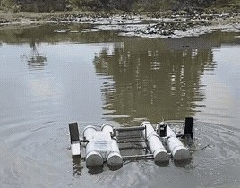
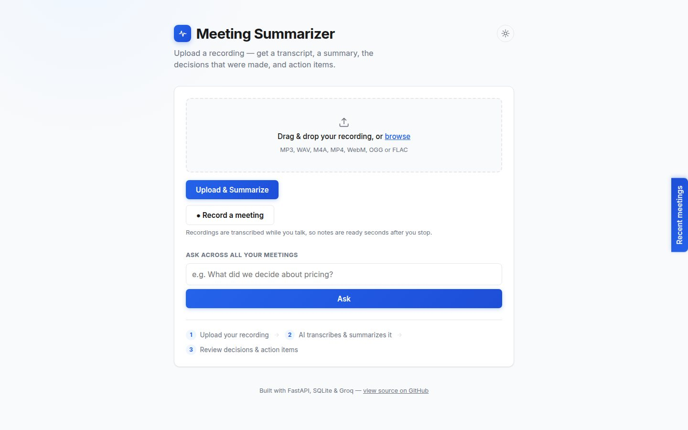
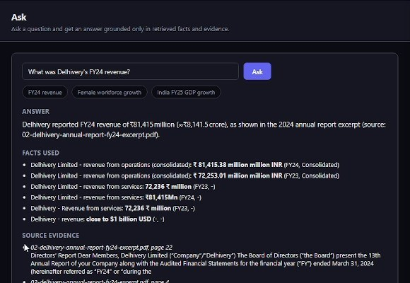
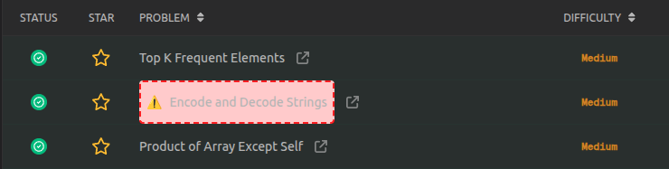

    

I'm a computer science student at VIT Chennai. Most of what I write is backend code in Python, and the part I enjoy most is working out what happens when things fail: a broker restarting mid-stream, a worker dying halfway through a job, an API running out of quota. I cause those failures on purpose, fix what breaks and write down what I measured.

## Latest project: water hyacinth collection boat

<table>
<tr>
<td width="64%" valign="top">

An autonomous boat that spots floating water hyacinth with a camera and collects it from ponds. **My college funded it with ₹30,000.** It was a team project, and I designed, built and programmed the boat, then tested it in a pond in October 2026.

The code and design stay private while a patent application is prepared.

   

</td>
<td width="36%" valign="top" align="center">
  
   Pond test, October 2026
</td>
</tr>
</table>

## Currently working on

<table>
<tr>
<td width="52%" valign="top">

### [linuxcru](https://github.com/colin-110/linux-cru)

Windows has CRU for adding custom refresh rates. On Linux, `xrandr` can't add modes on Wayland, and the reliable route, a boot-time EDID override, means working out a dozen timing values by hand, building a binary EDID and editing GRUB.

linuxcru does all of that from one number. It calculates the timings, writes a valid EDID and installs it as a kernel firmware override, on Wayland or X11 and with Secure Boot. Only a small helper runs as root, and every change can be previewed with `--dry-run`.

I built it so anyone can use it. It's open source, installs with pipx and works on Ubuntu, Debian, Linux Mint and other GRUB-based distros.

    

</td>
<td width="48%" valign="middle">
  
</td>
</tr>
</table>

## Projects

<table>
<tr>
<td width="50%" valign="top">

### [FleetOps](https://github.com/colin-110/robot-fleet-platform)
<a href="https://robot-fleet-platform.vercel.app">Live demo</a> · <a href="https://github.com/colin-110/robot-fleet-platform">Code</a>

Monitoring and control for a robot fleet. Readings are acknowledged only after they're committed and robots keep an on-disk outbox, so chaos tests that killed the robots, the API or the broker lost nothing. A shared predictor cuts robot messages by 55%.

   

</td>
<td width="50%" valign="top">

### [Lumen](https://github.com/colin-110/lumen)
<a href="https://lumen-three-nu.vercel.app">Live demo</a> · <a href="https://github.com/colin-110/lumen">Code</a>

A self-hosted document assistant that answers with citations. Hybrid search with ColBERT reranking takes 25 ms where a cross-encoder took 1.2 s, and numbers in each answer are checked against the passages they cite.

    

</td>
</tr>
<tr>
<td width="50%" valign="top">

### [Meeting Summarizer](https://github.com/colin-110/meeting-summarizer)
<a href="https://meeting-summarizer-recorder.vercel.app">Live app</a> · <a href="https://github.com/colin-110/meeting-summarizer">Code</a>

Turns a recording into a transcript, a summary, decisions and action items. Jobs run exactly once on a SQLite queue with leases and heartbeats instead of Redis and Celery, and long meetings are summarized while they're still being recorded.

   

</td>
<td width="50%" valign="top">

### [Papercut](https://github.com/colin-110/papercut)
<a href="https://colin-110-papercut.vercel.app">Live app</a> · <a href="https://github.com/colin-110/papercut">Code</a>

I built this for friends who aren't technical and needed to turn photos into PDFs, and they still use it. Everything runs in the browser with PDF.js, pdf-lib and Canvas, so files never leave the device.

   

</td>
</tr>
<tr>
<td colspan="2" valign="top">

### [Fact Knowledge Layer](https://github.com/colin-110/fact-knowledge-layer)
<a href="https://drive.google.com/file/d/11Ns9VgLIaBC0U2QHDBuwt0iK0OEf-YCN/view?usp=drive_link">Demo video</a> · <a href="https://github.com/colin-110/fact-knowledge-layer">Code</a>

 

Extracts facts from PDFs, links each one to the page it came from and flags when two reports disagree. Plain code normalizes currencies and periods, rules settle the clear cases, and only the ambiguous pairs go to an LLM.

   

</td>
</tr>
<tr>
<td colspan="2" valign="top">

### [Self-levelling platform on a line-following robot](https://github.com/colin-110/esp32-self-levelling-platform)

A line-following robot with a servo-mounted platform on top that stays level while it drives. The ESP32 runs line following on one core and levelling on the other.

Instead of PID, I wrote a controller that steps the servo towards level in small, bounded steps. Getting it stable on the real hardware took a lot of tuning: a four-stage filter on the tilt signal, a cap on each step and a check that stops correcting once the angle settles. I also built a [PID version](https://github.com/colin-110/mpu6050-servo-pid-controller) to compare. PID corrected faster, but my controller held the platform level too.

   

</td>
</tr>
</table>

## Other things I've built

<table>
<tr>
<td width="45%" valign="top">

**[NeetCode and LeetCode sync checker](https://github.com/colin-110/neetcode_leetcode_syncer)**

A Chrome extension that highlights problems I've ticked off on NeetCode but never actually solved on LeetCode. I use it most days when I practise.

 

</td>
<td width="55%" valign="middle">
  
</td>
</tr>
</table>

- [Robot kinematics simulator](https://github.com/colin-110/robot-kinematics-ik-simulator): forward and inverse kinematics for a 6-DOF arm, with a live 3D view
- [Algal bloom forecasting](https://github.com/colin-110/hab_project_ml): an XGBoost model that predicts harmful algal blooms from satellite and climate data

## Tools

        
       
       
