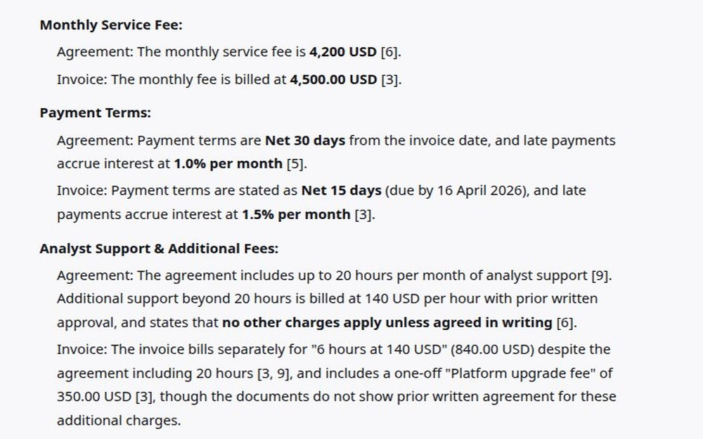

## Colin K Thomas

B.Tech Computer Science at VIT Chennai, graduating 2027. From Kerala, India. [LinkedIn](https://www.linkedin.com/in/colin-k-thomas)

I mostly write backend services in Python, and I focus on how they behave when parts of them fail: a broker restarting mid-stream, a worker dying halfway through a job, an API running out of quota. I test those failures directly and record the measurements alongside the code. The larger projects also have browser, load and smoke tests, and the smoke tests run against the live deployments. Outside backend work, I build Linux tooling and small robots.

### Water hyacinth collection boat

<table>
<tr>
<td width="64%" valign="top">

An autonomous boat that detects floating water hyacinth with a camera and collects it from ponds. A team project funded by my college with ₹30,000. I designed, built and programmed the boat and tested it on a pond in October 2026.

The code and design are private while a patent application is prepared.

Python · ESP32 · Jetson Orin Nano · computer vision

</td>
<td width="36%" valign="top" align="center">
  
   Pond test, October 2026
</td>
</tr>
</table>

### Currently working on: [linuxcru](https://github.com/colin-110/linux-cru)

<table>
<tr>
<td width="52%" valign="top">

Custom refresh rates for Linux, similar to CRU on Windows. On Wayland, `xrandr` can't add modes, and the reliable alternative, a boot-time EDID override, means calculating a dozen timing values by hand, building a binary EDID and editing GRUB.

linuxcru does this from a single number. It calculates the timings, writes a valid EDID and installs it as a kernel firmware override. It works on Wayland and X11 and with Secure Boot, runs only a small helper as root, and previews every change with `--dry-run`. I use it to run my laptop's 60 Hz panel at 96 Hz.

It installs with pipx on Ubuntu, Debian, Linux Mint and other distros that use GRUB and initramfs-tools. CI requires 90% test coverage, and each release goes through a manual test plan on real hardware.

Python · Qt (PySide6) · EDID · pytest · GPL-3.0

</td>
<td width="48%" valign="middle">
  
</td>
</tr>
</table>

### Projects

<table>
<tr>
<td width="50%" valign="top">

**[FleetOps](https://github.com/colin-110/robot-fleet-platform)** 
<a href="https://robot-fleet-platform.vercel.app">Live demo</a> · <a href="https://github.com/colin-110/robot-fleet-platform">Code</a>

Monitoring and control for a robot fleet. Readings are acknowledged only after they are committed, and each robot keeps an on-disk outbox, so chaos tests that killed the robots, the API or the broker with `kill -9` lost no readings. A predictor shared by robot and server cut messages by 55% in simulation, and one API process handled 1,000 robots at 35% of a CPU core.

FastAPI · MQTT · TimescaleDB · React · 942 tests in CI

</td>
<td width="50%" valign="top">

**[Lumen](https://github.com/colin-110/lumen)** 
<a href="https://lumen-three-nu.vercel.app">Live demo</a> · <a href="https://github.com/colin-110/lumen">Code</a>

Self-hosted document question answering with citations. Hybrid search with ColBERT reranking reaches 98% Recall@5 on its evaluation set in 25 ms; a cross-encoder reached 100% but took 1.2 s. Figures in each answer are checked against the passages they cite.

FastAPI · Qdrant · PostgreSQL · Celery · Next.js

</td>
</tr>
<tr>
<td width="50%" valign="top">

**[Meeting Summarizer](https://github.com/colin-110/meeting-summarizer)** 
<a href="https://meeting-summarizer-recorder.vercel.app">Live app</a> · <a href="https://github.com/colin-110/meeting-summarizer">Code</a>

Turns a recording into a transcript, summary, decisions and action items. Jobs run exactly once on a SQLite queue with leases and heartbeats, without Redis or Celery. Long meetings are summarized while they are recorded, which brought notes from 65.7 s to 14.8 s after stopping in testing. A smoke test runs against the live app daily.

FastAPI · SQLite · Whisper · FFmpeg · AWS Lightsail

</td>
<td width="50%" valign="top">

**[Papercut](https://github.com/colin-110/papercut)** 
<a href="https://colin-110-papercut.vercel.app">Live app</a> · <a href="https://github.com/colin-110/papercut">Code</a>

Converts photos to PDF and PDFs to images entirely in the browser with PDF.js, pdf-lib and Canvas, so files never leave the device. Built for friends who needed it and still in regular use.

TypeScript · React · Vite

</td>
</tr>
<tr>
<td colspan="2" valign="top">

**[Fact Knowledge Layer](https://github.com/colin-110/fact-knowledge-layer)** 
<a href="https://drive.google.com/file/d/11Ns9VgLIaBC0U2QHDBuwt0iK0OEf-YCN/view?usp=drive_link">Demo video</a> · <a href="https://github.com/colin-110/fact-knowledge-layer">Code</a>

 

Extracts facts from PDFs, links each one to the page it came from and flags when two reports disagree. Plain code normalizes currencies and periods, rules settle the clear cases, and only ambiguous pairs go to an LLM.

FastAPI · SQLite · Chroma · PyMuPDF

</td>
</tr>
<tr>
<td colspan="2" valign="top">

**[Self-levelling platform on a line-following robot](https://github.com/colin-110/esp32-self-levelling-platform)**

A servo-mounted platform that stays level while the robot drives, with line following and levelling on separate ESP32 cores. The levelling controller moves the servo toward level in bounded steps instead of using PID, with a four-stage filter on the tilt signal and a check that stops correcting once the angle settles. A [PID version](https://github.com/colin-110/mpu6050-servo-pid-controller) built for comparison corrected faster; the step controller also held level, with no integral or derivative terms to tune.

C++ · ESP32 · FreeRTOS · MPU6500

</td>
</tr>
</table>

### Smaller projects

- [NeetCode and LeetCode sync checker](https://github.com/colin-110/neetcode_leetcode_syncer): a Chrome extension that highlights problems marked solved on NeetCode with no accepted LeetCode submission
- [Robot kinematics simulator](https://github.com/colin-110/robot-kinematics-ik-simulator): forward and inverse kinematics for a 6-DOF arm, with a live 3D view
- [Algal bloom forecasting](https://github.com/colin-110/hab_project_ml): an XGBoost model that predicts harmful algal blooms from satellite and climate data
- [Hybrid intrusion detection](https://github.com/colin-110/Hybrid_IDS_ml_crypto): a Random Forest for known attacks and an Isolation Forest for unusual traffic, trained on UNSW-NB15 and run on live Windows network activity

### Tools

| Area | Tools |
|---|---|
| Languages | Python, C++, TypeScript, JavaScript, Java, SQL |
| Backend | FastAPI, MQTT, Celery |
| Data | PostgreSQL, TimescaleDB, SQLite, Redis, Qdrant |
| Frontend | React, Next.js |
| Testing and operations | pytest, Playwright, Docker, GitHub Actions, AWS, Prometheus, Grafana, Linux |
| Embedded | ESP32, FreeRTOS |
