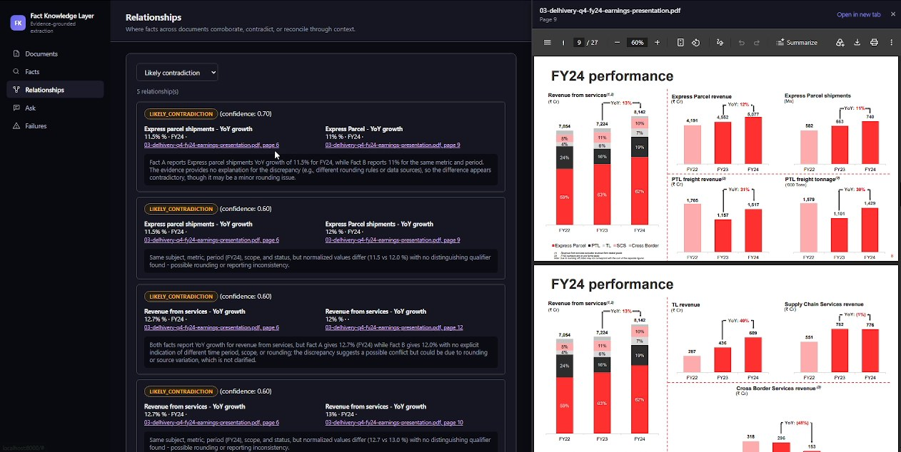

## Colin K Thomas

CS at VIT Chennai, class of 2027 · Kerala · [LinkedIn](https://www.linkedin.com/in/colin-k-thomas)

Mostly backend work in Python. I like finding out what breaks.

### Now

<table>
<tr>
<td width="50%" valign="top" align="center">

</td>
<td width="50%" valign="top">

</td>
</tr>
<tr>
<td valign="top">

**Water hyacinth boat**: finds water hyacinth with a camera and collects it from ponds. Funded by my college. Code private while a patent application is prepared.

</td>
<td valign="top">

**[linuxcru](https://github.com/colin-110/linux-cru)**: custom refresh rates on Linux. Runs my 60 Hz laptop panel at 96 Hz.

**[Install it →](https://github.com/colin-110/linux-cru#installation)** one pipx command

</td>
</tr>
</table>

### Projects

<table>
<tr>
<td width="50%" valign="top">

**[FleetOps](https://github.com/colin-110/robot-fleet-platform)**: a live fleet of 20 simulated robots. Kill any part mid-stream and no readings are lost.

**[Open the live fleet →](https://robot-fleet-platform.vercel.app)** login is pre-filled
</td>
<td width="50%" valign="top">

**[Lumen](https://github.com/colin-110/lumen)**: ask questions about contracts and invoices. Every answer cites its source.

**[Ask it something →](https://lumen-three-nu.vercel.app)** login is pre-filled
</td>
</tr>
<tr>
<td width="50%" valign="top">

**[Meeting Summarizer](https://github.com/colin-110/meeting-summarizer)**: record a meeting in your browser. Notes are ready seconds after you stop.

**[Record something →](https://meeting-summarizer-recorder.vercel.app)** no account needed
</td>
<td width="50%" valign="top">

**[Papercut](https://github.com/colin-110/papercut)**: photos to PDF and back, in your browser. Nothing gets uploaded.

**[Convert a photo →](https://colin-110-papercut.vercel.app)** no account needed
</td>
</tr>
<tr>
<td colspan="2" valign="top">
 

**[Fact Knowledge Layer](https://github.com/colin-110/fact-knowledge-layer)**: pulls facts out of PDFs and catches reports that contradict each other.

**[Watch the demo →](https://drive.google.com/file/d/11Ns9VgLIaBC0U2QHDBuwt0iK0OEf-YCN/view?usp=drive_link)**
</td>
</tr>
</table>

### Also

- [Self-levelling platform](https://github.com/colin-110/esp32-self-levelling-platform): ESP32 robot platform that stays level without PID
- [NeetCode sync checker](https://github.com/colin-110/neetcode_leetcode_syncer): Chrome extension for problems ticked on NeetCode but not solved on LeetCode
- [Kinematics simulator](https://github.com/colin-110/robot-kinematics-ik-simulator) · [Algal bloom forecasting](https://github.com/colin-110/hab_project_ml) · [Intrusion detection](https://github.com/colin-110/Hybrid_IDS_ml_crypto)

### Stack

Python, C++, TypeScript, SQL · FastAPI, PostgreSQL, Redis, MQTT · Docker, AWS, GitHub Actions · ESP32
